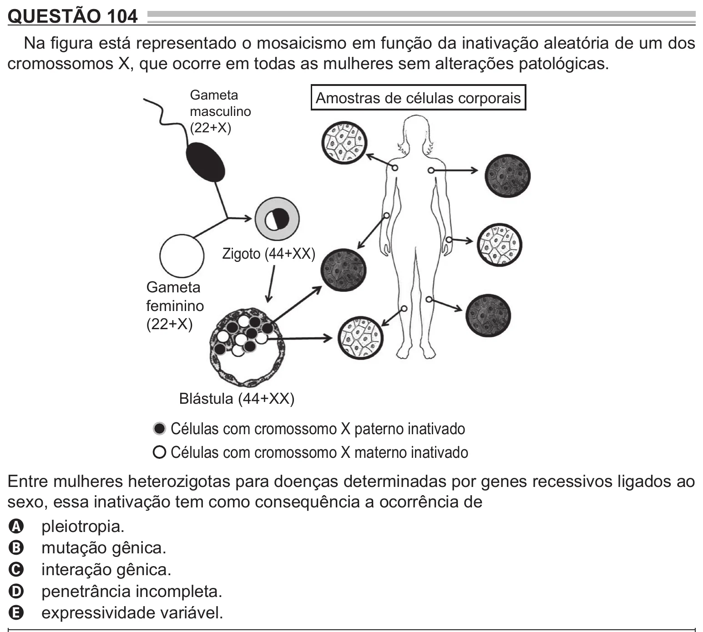

Texto extraído (pode conter ruído)

QUESTÃO 104  
Na figura está representado o mosaicismo em função da inativação aleatória de um dos  
cromossomos X, que ocorre em todas as mulheres sem alterações patológicas.  
Gameta  
Amostras de células corporais  
masculino  
(22+X)  
Zigoto (44+XX)  
Gameta  
feminino  
(22+X)  
Blástula (44+XX)  
Células com cromossomo X paterno inativado  
Células com cromossomo X materno inativado  
Entre mulheres heterozigotas para doenças determinadas por genes recessivos ligados ao  
sexo, essa inativação tem como consequência a ocorrência de  
A pleiotropia.  
B mutação gênica.  
C interação gênica.  
D penetrância incompleta.  
E expressividade variável.

