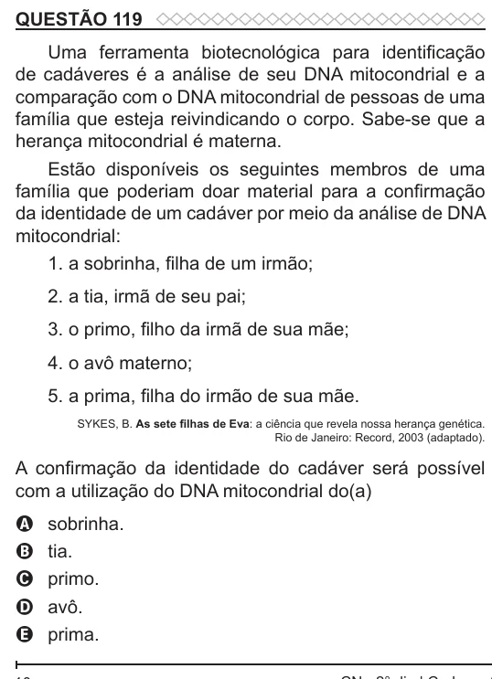

Texto extraído (pode conter ruído)

QUESTÃO 119  
Uma ferramenta biotecnológica para identificação  
de cadáveres é a análise de seu DNA mitocondrial e a  
comparação com o DNA mitocondrial de pessoas de uma  
família que esteja reivindicando o corpo. Sabe-se que a  
herança mitocondrial é materna.  
Estão disponíveis os seguintes membros de uma  
família que poderiam doar material para a confirmação  
da identidade de um cadáver por meio da análise de DNA  
mitocondrial:  
1. a sobrinha, filha de um irmão;  
2. a tia, irmã de seu pai;  
3. o primo, filho da irmã de sua mãe;  
4. o avô materno;  
5. a prima, filha do irmão de sua mãe.  
SYKES, B. As sete filhas de Eva: a ciência que revela nossa herança genética.  
Rio de Janeiro: Record, 2003 (adaptado).  
A confirmação da identidade do cadáver será possível  
com a utilização do DNA mitocondrial do(a)  
sobrinha.  
A  
tia.  
B  
primo.  
C  
avô.  
D  
prima.  
E

