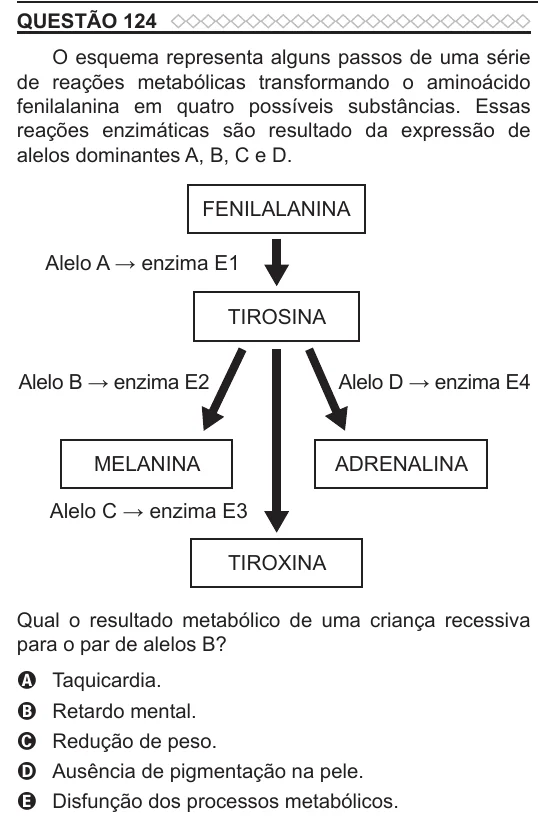

Texto extraído (pode conter ruído)

QUESTÃO 124  
O esquema representa alguns passos de uma série  
de reações metabólicas transformando o aminoácido  
fenilalanina em quatro possíveis substâncias. Essas  
reações enzimáticas são resultado da expressão de  
alelos dominantes A, B, C e D.  
FENILALANINA  
Alelo A → enzima E1  
TIROSINA  
Alelo B → enzima E2  
Alelo D → enzima E4  
MELANINA  
ADRENALINA  
Alelo C → enzima E3  
TIROXINA  
Qual o resultado metabólico de uma criança recessiva  
para o par de alelos B?  
Taquicardia.  
A  
Retardo mental.  
B  
Redução de peso.  
C  
Ausência de pigmentação na pele.  
D  
E  
Disfunção dos processos metabólicos.

