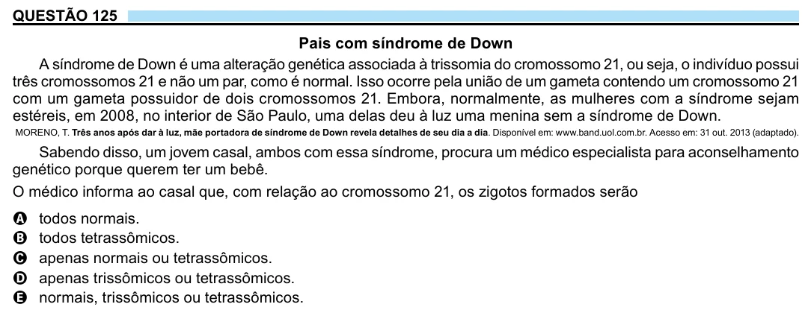

Texto extraído (pode conter ruído)

QUESTÃO 125  
Pais com síndrome de Down  
A síndrome de Down é uma alteração genética associada à trissomia do cromossomo 21, ou seja, o indivíduo possui  
três cromossomos 21 e não um par, como é normal. Isso ocorre pela união de um gameta contendo um cromossomo 21  
com um gameta possuidor de dois cromossomos 21. Embora, normalmente, as mulheres com a síndrome sejam  
estéreis, em 2008, no interior de São Paulo, uma delas deu à luz uma menina sem a síndrome de Down.  
MORENO, T. Três anos após dar à luz, mãe portadora de síndrome de Down revela detalhes de seu dia a dia. Disponível em: www.band.uol.com.br. Acesso em: 31 out. 2013 (adaptado).  
Sabendo disso, um jovem casal, ambos com essa síndrome, procura um médico especialista para aconselhamento  
genético porque querem ter um bebê.  
O médico informa ao casal que, com relação ao cromossomo 21, os zigotos formados serão  
todos normais.  
A  
todos tetrassômicos.  
B  
C  
apenas normais ou tetrassômicos.  
apenas trissômicos ou tetrassômicos.  
D  
normais, trissômicos ou tetrassômicos.  
E

