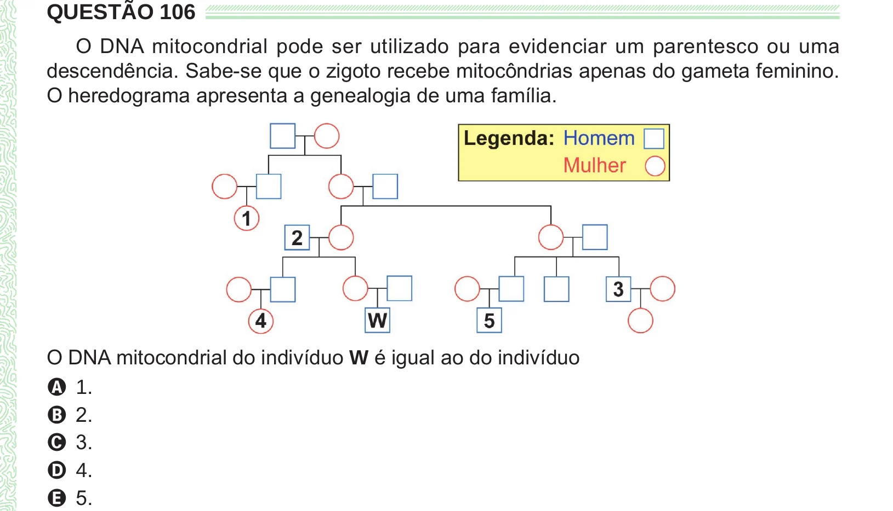

Texto extraído (pode conter ruído)

QUESTÃO 106  
O DNA mitocondrial pode ser utilizado para evidenciar um parentesco ou uma  
descendência. Sabe-se que o zigoto recebe mitocôndrias apenas do gameta feminino.  
O heredograma apresenta a genealogia de uma família.  
O DNA mitocondrial do indivíduo W é igual ao do indivíduo  
A 1.  
B 2.  
C 3.  
D 4.  
E 5.

