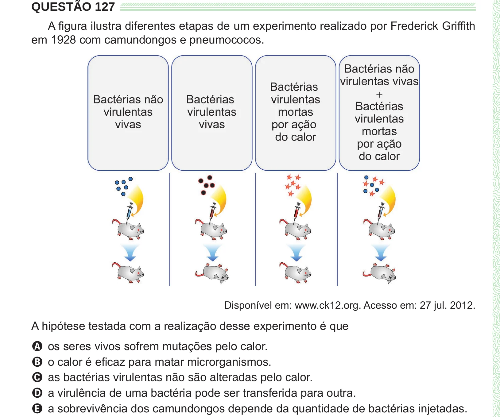

Texto extraído (pode conter ruído)

QUESTÃO 127  
A figura ilustra diferentes etapas de um experimento realizado por Frederick Griffith  
em 1928 com camundongos e pneumococos.  
Disponível em: www.ck12.org. Acesso em: 27 jul. 2012.  
A hipótese testada com a realização desse experimento é que  
A os seres vivos sofrem mutações pelo calor.  
B o calor é eficaz para matar microrganismos.  
C as bactérias virulentas não são alteradas pelo calor.  
D a virulência de uma bactéria pode ser transferida para outra.  
E a sobrevivência dos camundongos depende da quantidade de bactérias injetadas.

