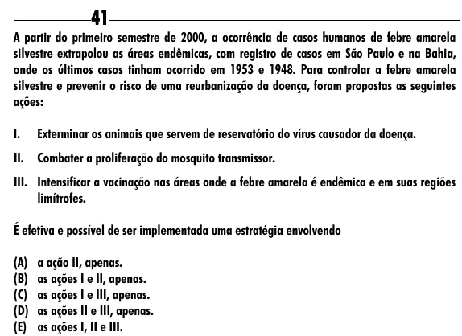

Texto extraído (pode conter ruído)

41  
A partir do primeiro semestre de 2000, a ocorrência de casos humanos de febre amarela  
silvestre extrapolou as áreas endêmicas, com registro de casos em São Paulo e na Bahia,  
onde os últimos casos tinham ocorrido em 1953 e 1948. Para controlar a febre amarela  
silvestre e prevenir o risco de uma reurbanização da doença, foram propostas as seguintes  
ações:  
I.  
Exterminar os animais que servem de reservatório do vírus causador da doença.  
II.  
Combater a proliferação do mosquito transmissor.  
III. Intensificar a vacinação nas áreas onde a febre amarela é endêmica e em suas regiões  
limítrofes.  
É efetiva e possível de ser implementada uma estratégia envolvendo  
(A) a ação II, apenas.  
(B) as ações I e II, apenas.  
(C) as ações I e III, apenas.  
(D) as ações II e III, apenas.  
(E) as ações I, II e III.

