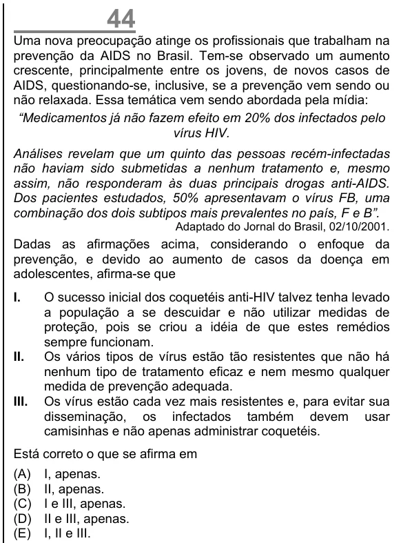

Texto extraído (pode conter ruído)

44  
Uma nova preocupação atinge os profissionais que trabalham na  
prevenção da AIDS no Brasil. Tem-se observado um aumento  
crescente, principalmente entre os jovens, de novos casos de  
AIDS, questionando-se, inclusive, se a prevenção vem sendo ou  
não relaxada. Essa temática vem sendo abordada pela mídia:  
“Medicamentos já não fazem efeito em 20% dos infectados pelo  
vírus HIV.  
Análises revelam que um quinto das pessoas recém-infectadas  
não haviam sido submetidas a nenhum tratamento e, mesmo  
assim, não responderam às duas principais drogas anti-AIDS.  
Dos pacientes estudados, 50% apresentavam o vírus FB, uma  
combinação dos dois subtipos mais prevalentes no país, F e B”.  
Adaptado do Jornal do Brasil, 02/10/2001.  
Dadas as afirmações acima, considerando o enfoque da  
prevenção, e devido ao aumento de casos da doença em  
adolescentes, afirma-se que  
I.  
O sucesso inicial dos coquetéis anti-HIV talvez tenha levado  
a população a se descuidar e não utilizar medidas de  
proteção, pois se criou a idéia de que estes remédios  
sempre funcionam.  
II.  
Os vários tipos de vírus estão tão resistentes que não há  
nenhum tipo de tratamento eficaz e nem mesmo qualquer  
medida de prevenção adequada.  
III.  
Os vírus estão cada vez mais resistentes e, para evitar sua  
disseminação, os infectados também devem usar  
camisinhas e não apenas administrar coquetéis.  
Está correto o que se afirma em  
(A)  
I, apenas.  
(B)  
II, apenas.  
(C)  
I e III, apenas.  
(D)  
II e III, apenas.  
(E)  
I, II e III.

