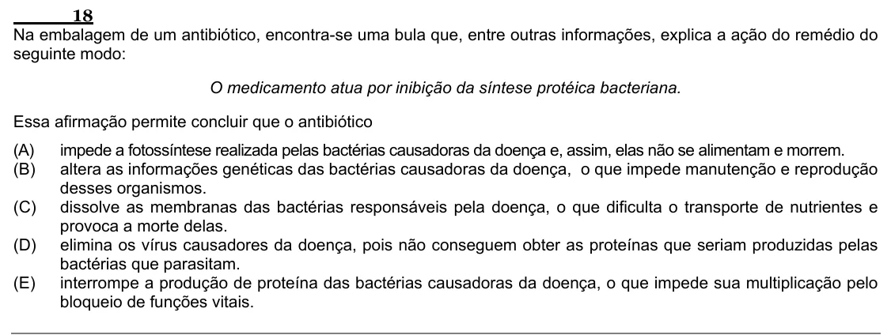

Texto extraído (pode conter ruído)

18  
Na embalagem de um antibiótico, encontra-se uma bula que, entre outras informações, explica a ação do remédio do  
seguinte modo:  
O medicamento atua por inibição da síntese protéica bacteriana.  
Essa afirmação permite concluir que o antibiótico  
(A)  
impede a fotossíntese realizada pelas bactérias causadoras da doença e, assim, elas não se alimentam e morrem.  
(B)  
altera as informações genéticas das bactérias causadoras da doença, o que impede manutenção e reprodução  
desses organismos.  
(C)  
dissolve as membranas das bactérias responsáveis pela doença, o que dificulta o transporte de nutrientes e  
provoca a morte delas.  
(D)  
elimina os vírus causadores da doença, pois não conseguem obter as proteínas que seriam produzidas pelas  
bactérias que parasitam.  
(E)  
interrompe a produção de proteína das bactérias causadoras da doença, o que impede sua multiplicação pelo  
bloqueio de funções vitais.

