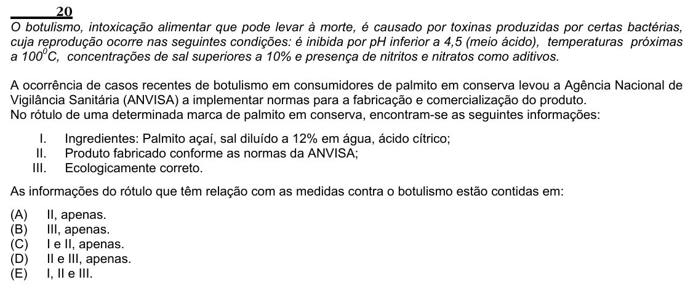

Texto extraído (pode conter ruído)

20  
O botulismo, intoxicação alimentar que pode levar à morte, é causado por toxinas produzidas por certas bactérias,  
cuja reprodução ocorre nas seguintes condições: é inibida por pH inferior a 4,5 (meio ácido), temperaturas próximas  
a 100 0 C, concentrações de sal superiores a 10% e presença de nitritos e nitratos como aditivos.  
A ocorrência de casos recentes de botulismo em consumidores de palmito em conserva levou a Agência Nacional de  
Vigilância Sanitária (ANVISA) a implementar normas para a fabricação e comercialização do produto.  
No rótulo de uma determinada marca de palmito em conserva, encontram-se as seguintes informações:  
I.  
Ingredientes: Palmito açaí, sal diluído a 12% em água, ácido cítrico;  
II.  
Produto fabricado conforme as normas da ANVISA;  
III.  
Ecologicamente correto.  
As informações do rótulo que têm relação com as medidas contra o botulismo estão contidas em:  
(A)  
II, apenas.  
(B)  
III, apenas.  
(C)  
I e II, apenas.  
(D)  
II e III, apenas.  
(E)  
I, II e III.

