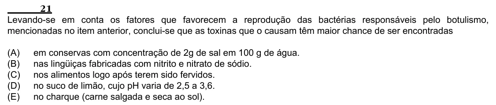

Texto extraído (pode conter ruído)

21  
Levando-se em conta os fatores que favorecem a reprodução das bactérias responsáveis pelo botulismo,  
mencionadas no item anterior, conclui-se que as toxinas que o causam têm maior chance de ser encontradas  
(A)  
em conservas com concentração de 2g de sal em 100 g de água.  
(B)  
nas lingüiças fabricadas com nitrito e nitrato de sódio.  
(C)  
nos alimentos logo após terem sido fervidos.  
(D)  
no suco de limão, cujo pH varia de 2,5 a 3,6.  
(E)  
no charque (carne salgada e seca ao sol).

