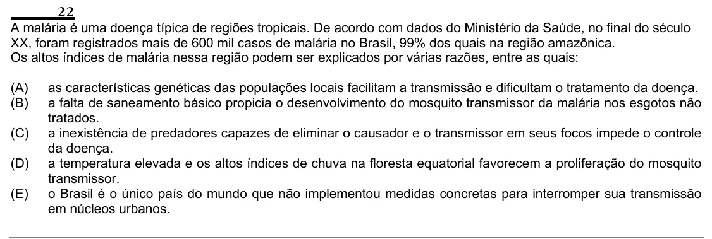

Texto extraído (pode conter ruído)

22  
A malária é uma doença típica de regiões tropicais. De acordo com dados do Ministério da Saúde, no final do século  
XX, foram registrados mais de 600 mil casos de malária no Brasil, 99% dos quais na região amazônica.  
Os altos índices de malária nessa região podem ser explicados por várias razões, entre as quais:  
(A)  
as características genéticas das populações locais facilitam a transmissão e dificultam o tratamento da doença.  
(B)  
a falta de saneamento básico propicia o desenvolvimento do mosquito transmissor da malária nos esgotos não  
tratados.  
(C)  
a inexistência de predadores capazes de eliminar o causador e o transmissor em seus focos impede o controle  
da doença.  
(D)  
a temperatura elevada e os altos índices de chuva na floresta equatorial favorecem a proliferação do mosquito  
transmissor.  
(E)  
o Brasil é o único país do mundo que não implementou medidas concretas para interromper sua transmissão  
em núcleos urbanos.

