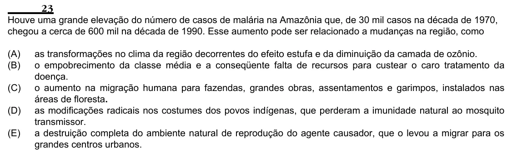

Texto extraído (pode conter ruído)

23  
Houve uma grande elevação do número de casos de malária na Amazônia que, de 30 mil casos na década de 1970,  
chegou a cerca de 600 mil na década de 1990. Esse aumento pode ser relacionado a mudanças na região, como  
(A)  
as transformações no clima da região decorrentes do efeito estufa e da diminuição da camada de ozônio.  
(B)  
o empobrecimento da classe média e a conseqüente falta de recursos para custear o caro tratamento da  
doença.  
(C)  
o aumento na migração humana para fazendas, grandes obras, assentamentos e garimpos, instalados nas  
áreas de floresta.  
(D)  
as modificações radicais nos costumes dos povos indígenas, que perderam a imunidade natural ao mosquito  
transmissor.  
(E)  
a destruição completa do ambiente natural de reprodução do agente causador, que o levou a migrar para os  
grandes centros urbanos.

