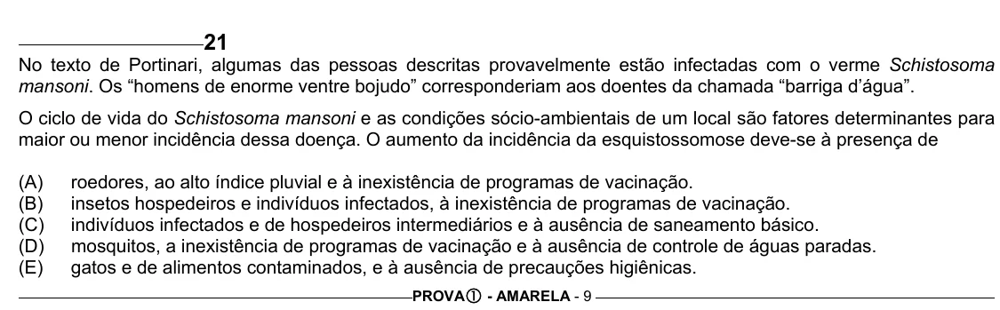

Texto extraído (pode conter ruído)

21  
No texto de Portinari, algumas das pessoas descritas provavelmente estão infectadas com o verme Schistosoma  
mansoni. Os “homens de enorme ventre bojudo” corresponderiam aos doentes da chamada “barriga d’água”.  
O ciclo de vida do Schistosoma mansoni e as condições sócio-ambientais de um local são fatores determinantes para  
maior ou menor incidência dessa doença. O aumento da incidência da esquistossomose deve-se à presença de  
(A)  
roedores, ao alto índice pluvial e à inexistência de programas de vacinação.  
(B)  
insetos hospedeiros e indivíduos infectados, à inexistência de programas de vacinação.  
(C)  
indivíduos infectados e de hospedeiros intermediários e à ausência de saneamento básico.  
(D)  
mosquitos, a inexistência de programas de vacinação e à ausência de controle de águas paradas.  
(E)  
gatos e de alimentos contaminados, e à ausência de precauções higiênicas.  
PROVA c - AMARELA - 9

