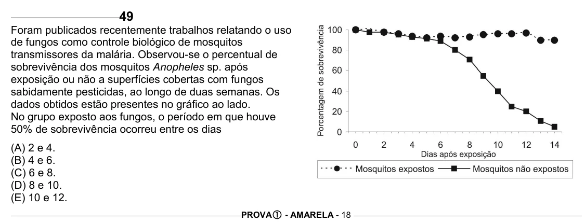

Texto extraído (pode conter ruído)

49  
Foram publicados recentemente trabalhos relatando o uso  
de fungos como controle biológico de mosquitos  
transmissores da malária. Observou-se o percentual de  
sobrevivência dos mosquitos Anopheles sp. após  
exposição ou não a superfícies cobertas com fungos  
sabidamente pesticidas, ao longo de duas semanas. Os  
dados obtidos estão presentes no gráfico ao lado.  
No grupo exposto aos fungos, o período em que houve  
50% de sobrevivência ocorreu entre os dias  
(A) 2 e 4.  
(B) 4 e 6.  
(C) 6 e 8.  
(D) 8 e 10.  
(E) 10 e 12.  
PROVA c - AMARELA - 18

