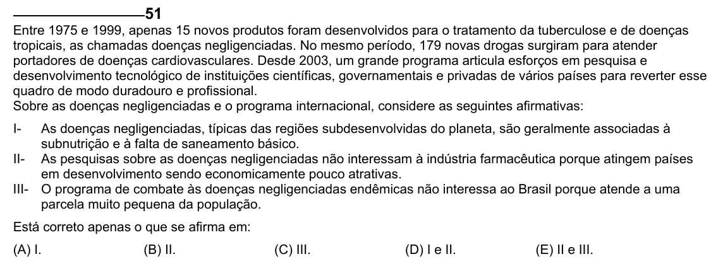

Texto extraído (pode conter ruído)

51  
Entre 1975 e 1999, apenas 15 novos produtos foram desenvolvidos para o tratamento da tuberculose e de doenças  
tropicais, as chamadas doenças negligenciadas. No mesmo período, 179 novas drogas surgiram para atender  
portadores de doenças cardiovasculares. Desde 2003, um grande programa articula esforços em pesquisa e  
desenvolvimento tecnológico de instituições científicas, governamentais e privadas de vários países para reverter esse  
quadro de modo duradouro e profissional.  
Sobre as doenças negligenciadas e o programa internacional, considere as seguintes afirmativas:  
I-  
As doenças negligenciadas, típicas das regiões subdesenvolvidas do planeta, são geralmente associadas à  
subnutrição e à falta de saneamento básico.  
II- As pesquisas sobre as doenças negligenciadas não interessam à indústria farmacêutica porque atingem países  
em desenvolvimento sendo economicamente pouco atrativas.  
III- O programa de combate às doenças negligenciadas endêmicas não interessa ao Brasil porque atende a uma  
parcela muito pequena da população.  
Está correto apenas o que se afirma em:  
(A) I.  
(B) II.  
(C) III.  
(D) I e II.  
(E) II e III.

