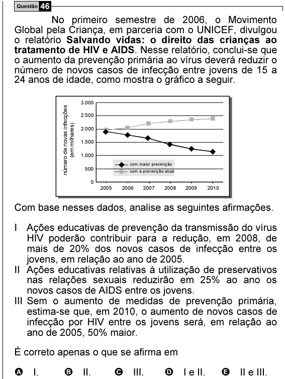

Texto extraído (pode conter ruído)

Questão 46  
No primeiro semestre de 2006, o Movimento  
Global pela Criança, em parceria com o UNICEF, divulgou  
o relatório Salvando vidas: o direito das crianças ao  
tratamento de HIV e AIDS. Nesse relatório, conclui-se que  
o aumento da prevenção primária ao vírus deverá reduzir o  
número de novos casos de infecção entre jovens de 15 a  
24 anos de idade, como mostra o gráfico a seguir.  
3.000  
número de novas infecções  
2.500  
(em milhares)  
2.000  
1.500  
1.000  
com maior prevenção  
500  
com a prevenção atual  
0  
2005  
2006  
2007  
2008  
2009  
2010  
Com base nesses dados, analise as seguintes afirmações.  
I Ações educativas de prevenção da transmissão do vírus  
HIV poderão contribuir para a redução, em 2008, de  
mais de 20% dos novos casos de infecção entre os  
jovens, em relação ao ano de 2005.  
II Ações educativas relativas à utilização de preservativos  
nas relações sexuais reduzirão em 25% ao ano os  
novos casos de AIDS entre os jovens.  
III Sem o aumento de medidas de prevenção primária,  
estima-se que, em 2010, o aumento de novos casos de  
infecção por HIV entre os jovens será, em relação ao  
ano de 2005, 50% maior.  
É correto apenas o que se afirma em  
A I.  
B II.  
C III.  
D I e II.  
E II e III.

