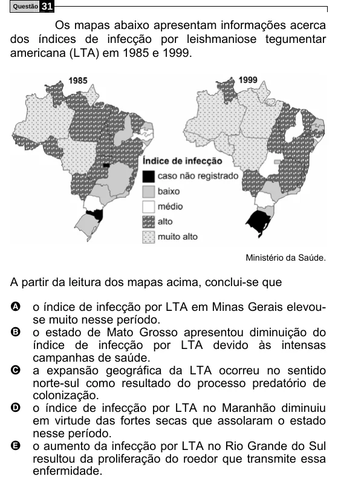

Texto extraído (pode conter ruído)

Questão  
31  
Os mapas abaixo apresentam informações acerca  
dos índices de infecção por leishmaniose tegumentar  
americana (LTA) em 1985 e 1999.  
Ministério da Saúde.  
A partir da leitura dos mapas acima, conclui-se que  
A o índice de infecção por LTA em Minas Gerais elevou-  
se muito nesse período.  
B o estado de Mato Grosso apresentou diminuição do  
índice de infecção por LTA devido às intensas  
campanhas de saúde.  
C a expansão geográfica da LTA ocorreu no sentido  
norte-sul como resultado do processo predatório de  
colonização.  
D o índice de infecção por LTA no Maranhão diminuiu  
em virtude das fortes secas que assolaram o estado  
nesse período.  
E o aumento da infecção por LTA no Rio Grande do Sul  
resultou da proliferação do roedor que transmite essa  
enfermidade.

