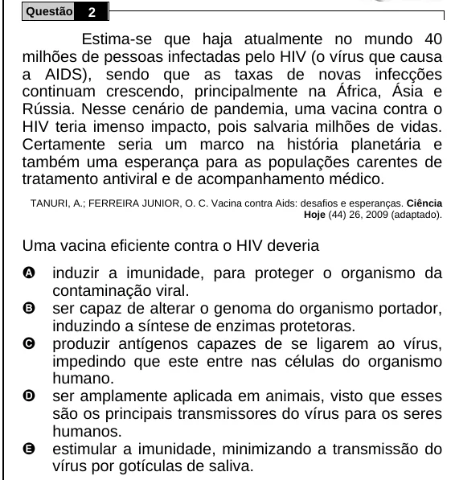

Texto extraído (pode conter ruído)

Questão  
2  
Estima-se que haja atualmente no mundo 40  
milhões de pessoas infectadas pelo HIV (o vírus que causa  
a AIDS), sendo que as taxas de novas infecções  
continuam crescendo, principalmente na África, Ásia e  
Rússia. Nesse cenário de pandemia, uma vacina contra o  
HIV teria imenso impacto, pois salvaria milhões de vidas.  
Certamente seria um marco na história planetária e  
também uma esperança para as populações carentes de  
tratamento antiviral e de acompanhamento médico.  
TANURI, A.; FERREIRA JUNIOR, O. C. Vacina contra Aids: desafios e esperanças. Ciência  
Hoje (44) 26, 2009 (adaptado).  
Uma vacina eficiente contra o HIV deveria  
A  
induzir a imunidade, para proteger o organismo da  
contaminação viral.  
B  
ser capaz de alterar o genoma do organismo portador,  
induzindo a síntese de enzimas protetoras.  
C  
produzir antígenos capazes de se ligarem ao vírus,  
impedindo que este entre nas células do organismo  
humano.  
D  
ser amplamente aplicada em animais, visto que esses  
são os principais transmissores do vírus para os seres  
humanos.  
E  
estimular a imunidade, minimizando a transmissão do  
vírus por gotículas de saliva.

