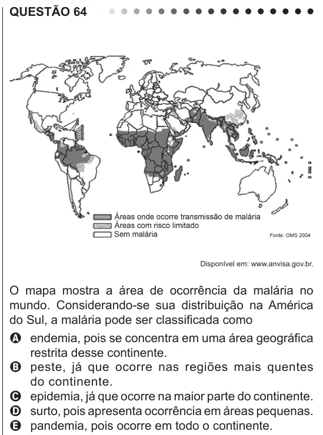

Texto extraído (pode conter ruído)

QUESTÃO 64  
Disponível em: www.anvisa.gov.br.  
O mapa mostra a área de ocorrência da malária no  
mundo. Considerando-se sua distribuição na América  
do Sul, a malária pode ser classificada como  
A endemia, pois se concentra em uma área geográfica  
restrita desse continente.  
B peste, já que ocorre nas regiões mais quentes  
do continente.  
C epidemia, já que ocorre na maior parte do continente.  
D surto, pois apresenta ocorrência em áreas pequenas.  
E pandemia, pois ocorre em todo o continente.

