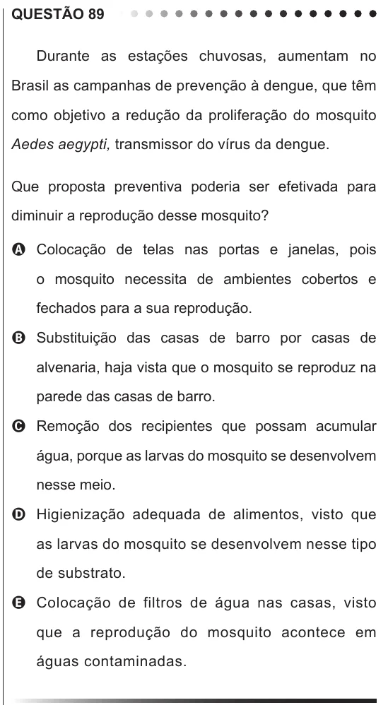

Texto extraído (pode conter ruído)

QUESTÃO 89  
Durante as estações chuvosas, aumentam no  
Brasil as campanhas de prevenção à dengue, que têm  
como objetivo a redução da proliferação do mosquito  
Aedes aegypti, transmissor do vírus da dengue.  
Que proposta preventiva poderia ser efetivada para  
diminuir a reprodução desse mosquito?  
A Colocação de telas nas portas e janelas, pois  
o mosquito necessita de ambientes cobertos e  
fechados para a sua reprodução.  
B Substituição das casas de barro por casas de  
alvenaria, haja vista que o mosquito se reproduz na  
parede das casas de barro.  
C Remoção dos recipientes que possam acumular  
água, porque as larvas do mosquito se desenvolvem  
nesse meio.  
D Higienização adequada de alimentos, visto que  
as larvas do mosquito se desenvolvem nesse tipo  
de substrato.  
E Colocação de filtros de água nas casas, visto  
que a reprodução do mosquito acontece em  
águas contaminadas.

