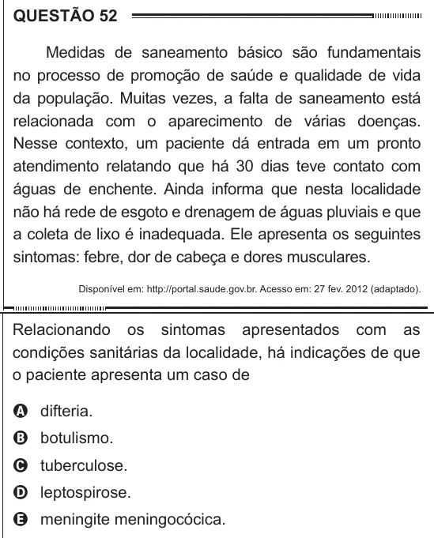

Texto extraído (pode conter ruído)

QUESTÃO 52  
Medidas de saneamento básico são fundamentais  
no processo de promoção de saúde e qualidade de vida  
da população. Muitas vezes, a falta de saneamento está  
relacionada com o aparecimento de várias doenças.  
Nesse contexto, um paciente dá entrada em um pronto  
atendimento relatando que há 30 dias teve contato com  
águas de enchente. Ainda informa que nesta localidade  
não há rede de esgoto e drenagem de águas pluviais e que  
a coleta de lixo é inadequada. Ele apresenta os seguintes  
sintomas: febre, dor de cabeça e dores musculares.  
Disponível em: http://portal.saude.gov.br. Acesso em: 27 fev. 2012 (adaptado).  
Relacionando os sintomas apresentados com as  
condições sanitárias da localidade, há indicações de que  
o paciente apresenta um caso de  
A difteria.  
B botulismo.  
C tuberculose.  
D leptospirose.  
E meningite meningocócica.

