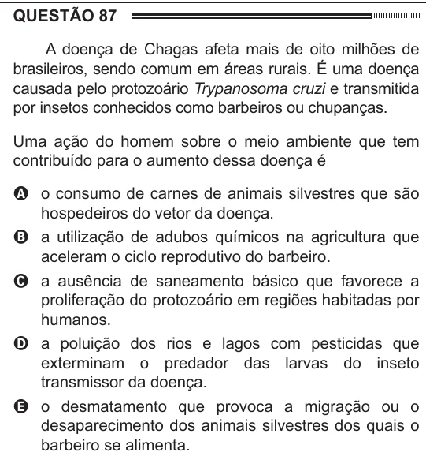

Texto extraído (pode conter ruído)

QUESTÃO 87  
A doença de Chagas afeta mais de oito milhões de  
brasileiros, sendo comum em áreas rurais. É uma doença  
causada pelo protozoário Trypanosoma cruzi e transmitida  
por insetos conhecidos como barbeiros ou chupanças.  
Uma ação do homem sobre o meio ambiente que tem  
contribuído para o aumento dessa doença é  
A o consumo de carnes de animais silvestres que são  
hospedeiros do vetor da doença.  
B a utilização de adubos químicos na agricultura que  
aceleram o ciclo reprodutivo do barbeiro.  
C a ausência de saneamento básico que favorece a  
proliferação do protozoário em regiões habitadas por  
humanos.  
D a poluição dos rios e lagos com pesticidas que  
exterminam o predador das larvas do inseto  
transmissor da doença.  
E o desmatamento que provoca a migração ou o  
desaparecimento dos animais silvestres dos quais o  
barbeiro se alimenta.

