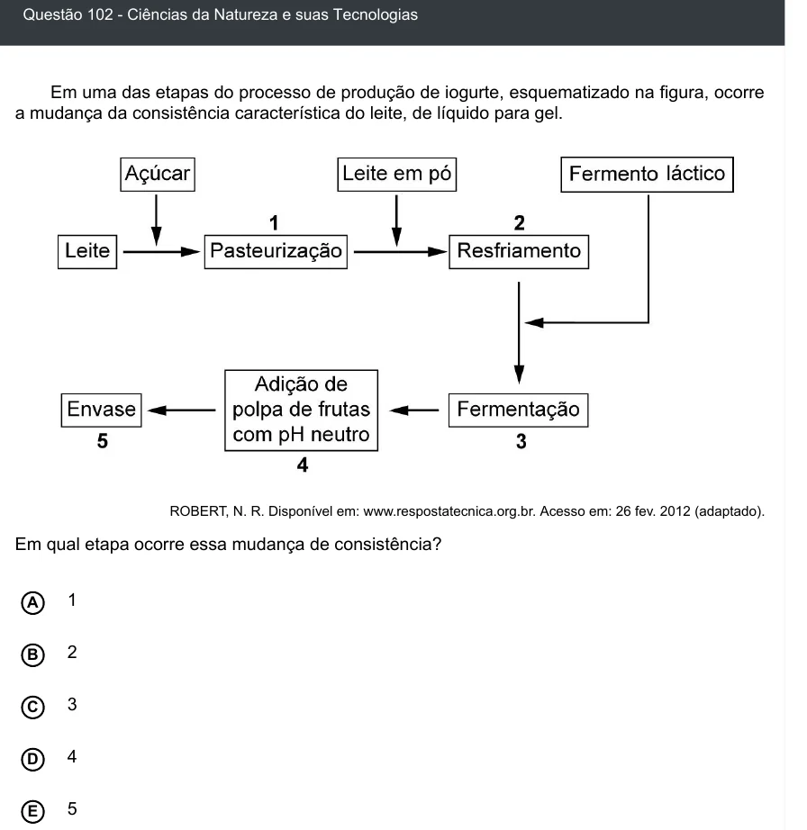

Texto extraído (pode conter ruído)

Questão 102 - Ciências da Natureza e suas Tecnologias  
Em uma das etapas do processo de produção de iogurte, esquematizado na figura, ocorre  
a mudança da consistência característica do leite, de líquido para gel.  
ROBERT, N. R. Disponível em: www.respostatecnica.org.br. Acesso em: 26 fev. 2012 (adaptado).  
Em qual etapa ocorre essa mudança de consistência?  
1  
A  
2  
B  
C  
3  
D  
4  
5  
E

