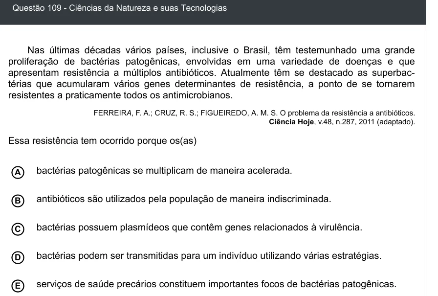

Texto extraído (pode conter ruído)

Questão 109 - Ciências da Natureza e suas Tecnologias  
Nas últimas décadas vários países, inclusive o Brasil, têm testemunhado uma grande  
prolifera ção de bactérias patogênicas, envol vidas em uma variedade de doenças e que  
apresentam resistência a múlti plos antibióticos. Atualmente têm se destacado as superbac-  
térias que acumularam vários genes determinantes de resis tência, a ponto de se tornarem  
resistentes a praticamente todos os antimicrobianos.  
FERREIRA, F. A.; CRUZ, R. S.; FIGUEIREDO, A. M. S. O problema da resistência a antibióticos.  
Ciência Hoje, v.48, n.287, 2011 (adaptado).  
Essa resistência tem ocorrido porque os(as)  
bactérias patogênicas se multiplicam de maneira acelerada.  
A  
antibióticos são utilizados pela população de maneira indiscriminada.  
B  
C  
bactérias possuem plasmídeos que contêm genes relacionados à virulência.  
bactérias podem ser transmitidas para um indivíduo utilizando várias estratégias.  
D  
serviços de saúde precários constituem importantes focos de bactérias patogênicas.  
E

