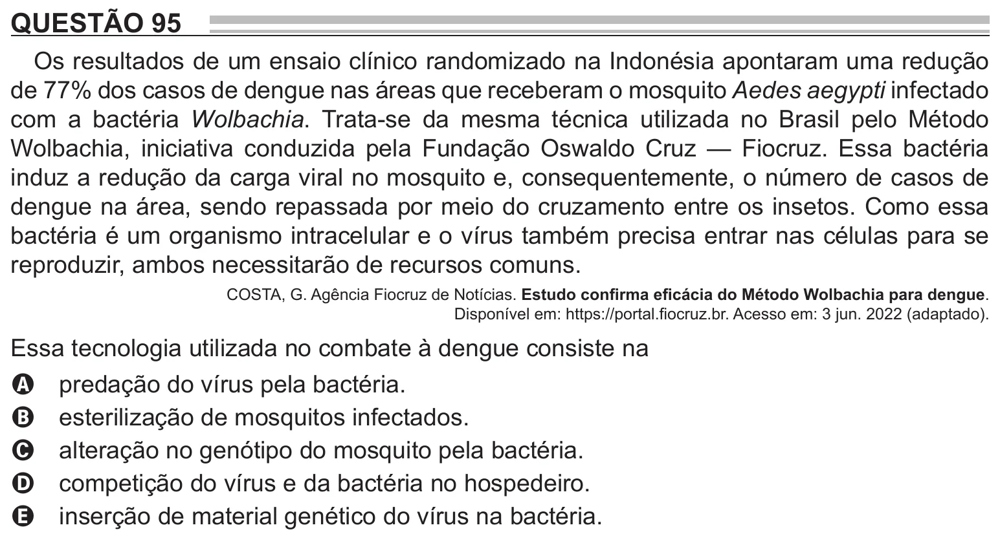

Texto extraído (pode conter ruído)

QUESTÃO 95  
Os resultados de um ensaio clínico randomizado na Indonésia apontaram uma redução  
de 77% dos casos de dengue nas áreas que receberam o mosquito Aedes aegypti infectado  
com a bactéria Wolbachia. Trata-se da mesma técnica utilizada no Brasil pelo Método  
Wolbachia, iniciativa conduzida pela Fundação Oswaldo Cruz — Fiocruz. Essa bactéria  
induz a redução da carga viral no mosquito e, consequentemente, o número de casos de  
dengue na área, sendo repassada por meio do cruzamento entre os insetos. Como essa  
bactéria é um organismo intracelular e o vírus também precisa entrar nas células para se  
reproduzir, ambos necessitarão de recursos comuns.  
COSTA, G. Agência Fiocruz de Notícias. Estudo confirma eficácia do Método Wolbachia para dengue.  
Disponível em: https://portal.fiocruz.br. Acesso em: 3 jun. 2022 (adaptado).  
Essa tecnologia utilizada no combate à dengue consiste na  
predação do vírus pela bactéria.  
A  
esterilização de mosquitos infectados.  
B  
alteração no genótipo do mosquito pela bactéria.  
C  
competição do vírus e da bactéria no hospedeiro.  
D  
inserção de material genético do vírus na bactéria.  
E

