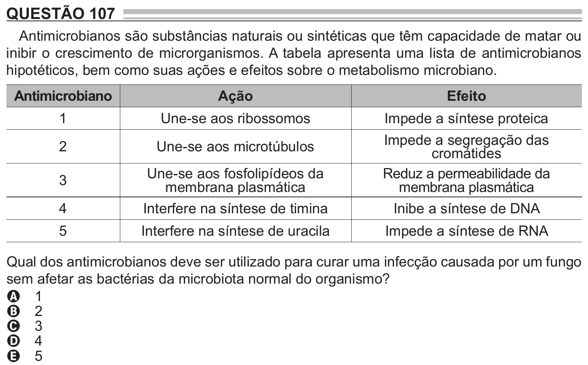

Texto extraído (pode conter ruído)

QUESTÃO 107  
Antimicrobianos são substâncias naturais ou sintéticas que têm capacidade de matar ou  
inibir o crescimento de microrganismos. A tabela apresenta uma lista de antimicrobianos  
hipotéticos, bem como suas ações e efeitos sobre o metabolismo microbiano.  
Antimicrobiano  
Ação  
Efeito  
1  
Une-se aos ribossomos  
Impede a síntese proteica  
Impede a segregação das  
2  
Une-se aos microtúbulos  
cromátides  
Une-se aos fosfolipídeos da  
Reduz a permeabilidade da  
3  
membrana plasmática  
membrana plasmática  
4  
Interfere na síntese de timina  
Inibe a síntese de DNA  
5  
Interfere na síntese de uracila  
Impede a síntese de RNA  
Qual dos antimicrobianos deve ser utilizado para curar uma infecção causada por um fungo  
sem afetar as bactérias da microbiota normal do organismo?  
A 1  
B 2  
C 3  
D 4  
E 5

