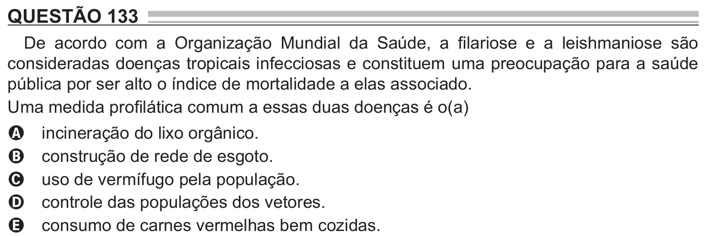

Texto extraído (pode conter ruído)

QUESTÃO 133  
De acordo com a Organização Mundial da Saúde, a filariose e a leishmaniose são  
consideradas doenças tropicais infecciosas e constituem uma preocupação para a saúde  
pública por ser alto o índice de mortalidade a elas associado.  
Uma medida profilática comum a essas duas doenças é o(a)  
incineração do lixo orgânico.  
A  
construção de rede de esgoto.  
B  
uso de vermífugo pela população.  
C  
controle das populações dos vetores.  
D  
consumo de carnes vermelhas bem cozidas.  
E

