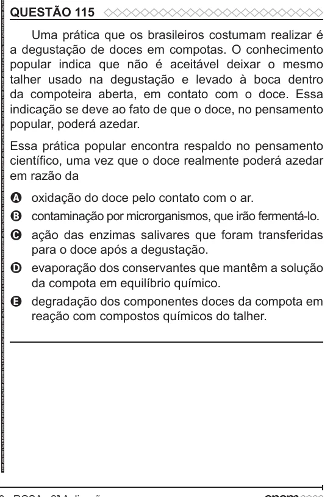

Texto extraído (pode conter ruído)

QUESTÃO 115  
Uma prática que os brasileiros costumam realizar é  
a degustação de doces em compotas. O conhecimento  
popular indica que não é aceitável deixar o mesmo  
talher usado na degustação e levado à boca dentro  
da compoteira aberta, em contato com o doce. Essa  
indicação se deve ao fato de que o doce, no pensamento  
popular, poderá azedar.  
Essa prática popular encontra respaldo no pensamento  
científico, uma vez que o doce realmente poderá azedar  
em razão da  
A oxidação do doce pelo contato com o ar.  
B contaminação por microrganismos, que irão fermentá-lo.  
C ação das enzimas salivares que foram transferidas  
para o doce após a degustação.  
D evaporação dos conservantes que mantêm a solução  
da compota em equilíbrio químico.  
E degradação dos componentes doces da compota em  
reação com compostos químicos do talher.

