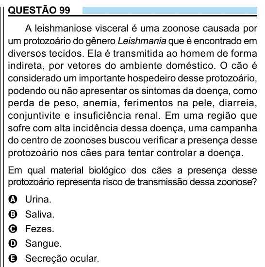

Texto extraído (pode conter ruído)

QUESTÃO 99  
A leishmaniose visceral é uma zoonose causada por  
um protozoário do gênero Leishmania que é encontrado em  
diversos tecidos. Ela é transmitida ao homem de forma  
indireta, por vetores do ambiente doméstico. O cão é  
considerado um importante hospedeiro desse protozoário,  
podendo ou não apresentar os sintomas da doença, como  
perda de peso, anemia, ferimentos na pele, diarreia,  
conjuntivite e insuficiência renal. Em uma região que  
sofre com alta incidência dessa doença, uma campanha  
do centro de zoonoses buscou verificar a presença desse  
protozoário nos cães para tentar controlar a doença.  
Em qual material biológico dos cães a presença desse  
protozoário representa risco de transmissão dessa zoonose?  
Urina.  
A  
Saliva.  
B  
Fezes.  
C  
D  
Sangue.  
E  
Secreção ocular.

