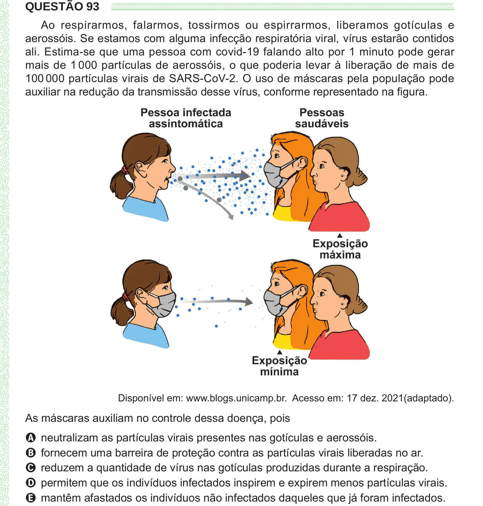

Texto extraído (pode conter ruído)

QUESTÃO 93  
Ao respirarmos, falarmos, tossirmos ou espirrarmos, liberamos gotículas e  
aerossóis. Se estamos com alguma infecção respiratória viral, vírus estarão contidos  
ali. Estima-se que uma pessoa com covid-19 falando alto por 1 minuto pode gerar  
mais de 1 000 partículas de aerossóis, o que poderia levar à liberação de mais de  
100 000 partículas virais de SARS-CoV-2. O uso de máscaras pela população pode  
auxiliar na redução da transmissão desse vírus, conforme representado na figura.  
Disponível em: www.blogs.unicamp.br. Acesso em: 17 dez. 2021(adaptado).  
As máscaras auxiliam no controle dessa doença, pois  
A neutralizam as partículas virais presentes nas gotículas e aerossóis.  
B fornecem uma barreira de proteção contra as partículas virais liberadas no ar.  
C reduzem a quantidade de vírus nas gotículas produzidas durante a respiração.  
D permitem que os indivíduos infectados inspirem e expirem menos partículas virais.  
E mantêm afastados os indivíduos não infectados daqueles que já foram infectados.

