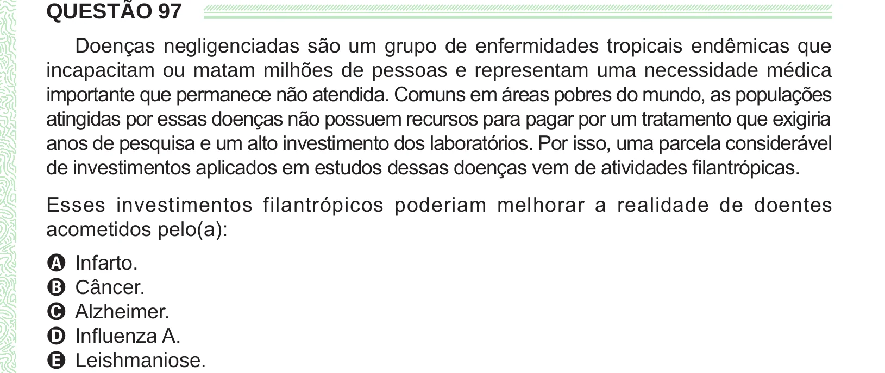

Texto extraído (pode conter ruído)

QUESTÃO 97  
Doenças negligenciadas são um grupo de enfermidades tropicais endêmicas que  
incapacitam ou matam milhões de pessoas e representam uma necessidade médica  
importante que permanece não atendida. Comuns em áreas pobres do mundo, as populações  
atingidas por essas doenças não possuem recursos para pagar por um tratamento que exigiria  
anos de pesquisa e um alto investimento dos laboratórios. Por isso, uma parcela considerável  
de investimentos aplicados em estudos dessas doenças vem de atividades filantrópicas.  
Esses investimentos filantrópicos poderiam melhorar a realidade de doentes  
acometidos pelo(a):  
A Infarto.  
B Câncer.  
C Alzheimer.  
D Influenza A.  
E Leishmaniose.

