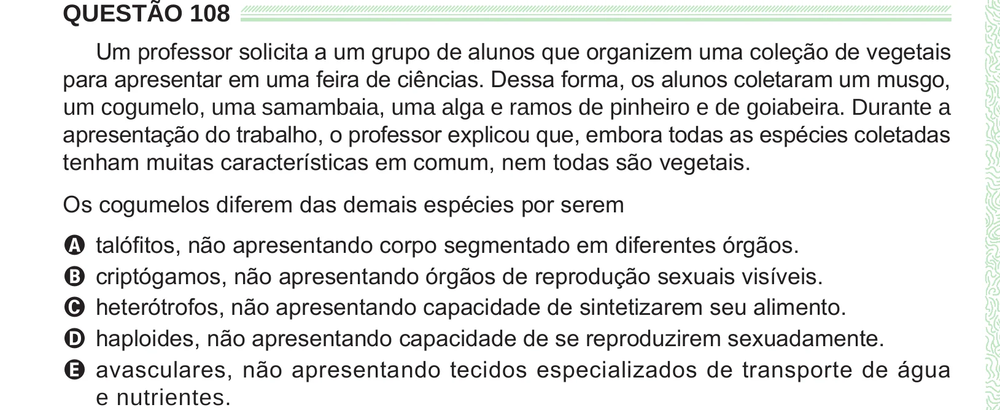

Texto extraído (pode conter ruído)

QUESTÃO 108  
Um professor solicita a um grupo de alunos que organizem uma coleção de vegetais  
para apresentar em uma feira de ciências. Dessa forma, os alunos coletaram um musgo,  
um cogumelo, uma samambaia, uma alga e ramos de pinheiro e de goiabeira. Durante a  
apresentação do trabalho, o professor explicou que, embora todas as espécies coletadas  
tenham muitas características em comum, nem todas são vegetais.  
Os cogumelos diferem das demais espécies por serem  
A talófitos, não apresentando corpo segmentado em diferentes órgãos.  
B criptógamos, não apresentando órgãos de reprodução sexuais visíveis.  
C heterótrofos, não apresentando capacidade de sintetizarem seu alimento.  
D haploides, não apresentando capacidade de se reproduzirem sexuadamente.  
E avasculares, não apresentando tecidos especializados de transporte de água  
e nutrientes.

