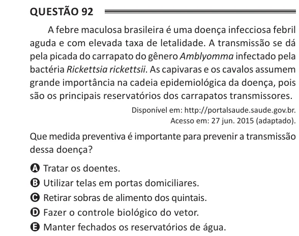

Texto extraído (pode conter ruído)

Questão 92  
A febre maculosa brasileira é uma doença infecciosa febril  
aguda e com elevada taxa de letalidade. A transmissão se dá  
pela picada do carrapato do gênero Amblyomma infectado pela  
bactéria Rickettsia rickettsii. As capivaras e os cavalos assumem  
grande importância na cadeia epidemiológica da doença, pois  
são os principais reservatórios dos carrapatos transmissores.  
Disponível em: http://portalsaude.saude.gov.br.  
Acesso em: 27 jun. 2015 (adaptado).  
Que medida preventiva é importante para prevenir a transmissão  
dessa doença?  
A Tratar os doentes.  
B Utilizar telas em portas domiciliares.  
C Retirar sobras de alimento dos quintais.  
D Fazer o controle biológico do vetor.  
E Manter fechados os reservatórios de água.

