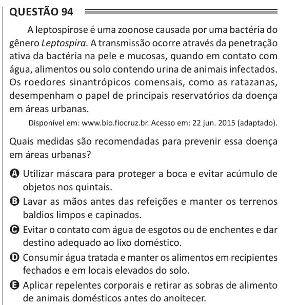

Texto extraído (pode conter ruído)

Questão 94  
A leptospirose é uma zoonose causada por uma bactéria do  
gênero Leptospira. A transmissão ocorre através da penetração  
ativa da bactéria na pele e mucosas, quando em contato com  
água, alimentos ou solo contendo urina de animais infectados.  
Os roedores sinantrópicos comensais, como as ratazanas,  
desempenham o papel de principais reservatórios da doença  
em áreas urbanas.  
Disponível em: www.bio.fiocruz.br. Acesso em: 22 jun. 2015 (adaptado).  
Quais medidas são recomendadas para prevenir essa doença  
em áreas urbanas?  
A Utilizar máscara para proteger a boca e evitar acúmulo de  
objetos nos quintais.  
B Lavar as mãos antes das refeições e manter os terrenos  
baldios limpos e capinados.  
C Evitar o contato com água de esgotos ou de enchentes e dar  
destino adequado ao lixo doméstico.  
D Consumir água tratada e manter os alimentos em recipientes  
fechados e em locais elevados do solo.  
E Aplicar repelentes corporais e retirar as sobras de alimento  
de animais domésticos antes do anoitecer.

