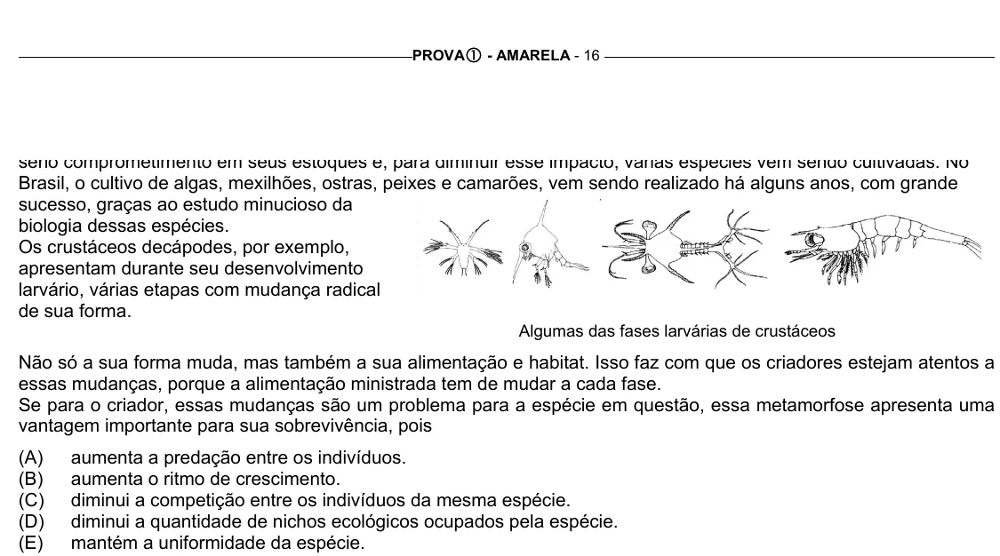

Texto extraído (pode conter ruído)

PROVA c - AMARELA - 16  
Brasil, o cultivo de algas, mexilhões, ostras, peixes e camarões, vem sendo realizado há alguns anos, com grande  
sucesso, graças ao estudo minucioso da  
biologia dessas espécies.  
Os crustáceos decápodes, por exemplo,  
apresentam durante seu desenvolvimento  
larvário, várias etapas com mudança radical  
de sua forma.  
Algumas das fases larvárias de crustáceos  
Não só a sua forma muda, mas também a sua alimentação e habitat. Isso faz com que os criadores estejam atentos a  
essas mudanças, porque a alimentação ministrada tem de mudar a cada fase.  
Se para o criador, essas mudanças são um problema para a espécie em questão, essa metamorfose apresenta uma  
vantagem importante para sua sobrevivência, pois  
(A)  
aumenta a predação entre os indivíduos.  
(B)  
aumenta o ritmo de crescimento.  
(C)  
diminui a competição entre os indivíduos da mesma espécie.  
(D)  
diminui a quantidade de nichos ecológicos ocupados pela espécie.  
(E)  
mantém a uniformidade da espécie.

