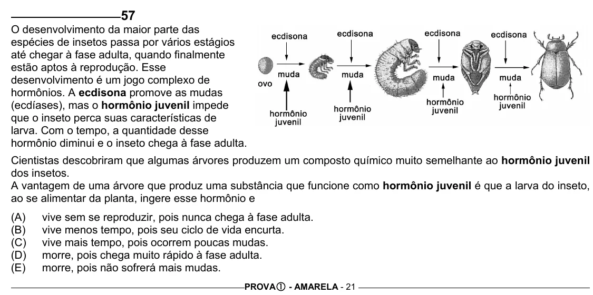

Texto extraído (pode conter ruído)

57  
O desenvolvimento da maior parte das  
espécies de insetos passa por vários estágios  
até chegar à fase adulta, quando finalmente  
estão aptos à reprodução. Esse  
desenvolvimento é um jogo complexo de  
hormônios. A ecdisona promove as mudas  
(ecdíases), mas o hormônio juvenil impede  
que o inseto perca suas características de  
larva. Com o tempo, a quantidade desse  
hormônio diminui e o inseto chega à fase adulta.  
Cientistas descobriram que algumas árvores produzem um composto químico muito semelhante ao hormônio juvenil  
dos insetos.  
A vantagem de uma árvore que produz uma substância que funcione como hormônio juvenil é que a larva do inseto,  
ao se alimentar da planta, ingere esse hormônio e  
(A)  
vive sem se reproduzir, pois nunca chega à fase adulta.  
(B)  
vive menos tempo, pois seu ciclo de vida encurta.  
(C)  
vive mais tempo, pois ocorrem poucas mudas.  
(D)  
morre, pois chega muito rápido à fase adulta.  
(E)  
morre, pois não sofrerá mais mudas.  
PROVA c - AMARELA - 21

