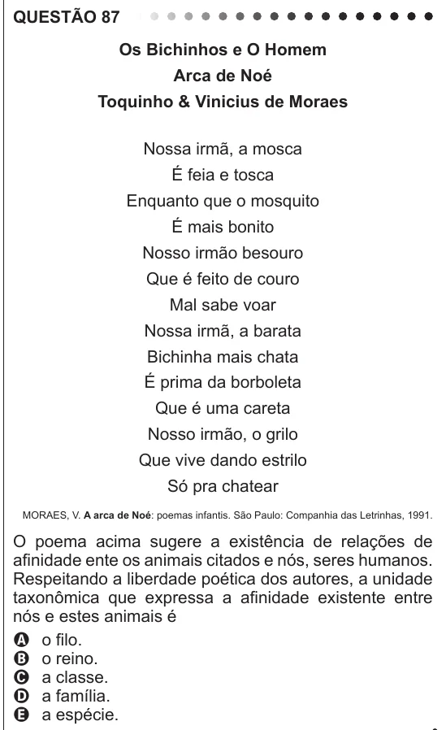

Texto extraído (pode conter ruído)

QUESTÃO 87  
Os Bichinhos e O Homem  
Arca de Noé  
Toquinho & Vinicius de Moraes  
Nossa irmã, a mosca  
É feia e tosca  
Enquanto que o mosquito  
É mais bonito  
Nosso irmão besouro  
Que é feito de couro  
Mal sabe voar  
Nossa irmã, a barata  
Bichinha mais chata  
É prima da borboleta  
Que é uma careta  
Nosso irmão, o grilo  
Que vive dando estrilo  
Só pra chatear  
MORAES, V. A arca de Noé: poemas infantis. São Paulo: Companhia das Letrinhas, 1991.  
O poema acima sugere a existência de relações de  
afinidade ente os animais citados e nós, seres humanos.  
Respeitando a liberdade poética dos autores, a unidade  
taxonômica que expressa a afinidade existente entre  
nós e estes animais é  
A o filo.  
B o reino.  
C a classe.  
D a família.  
E a espécie.

