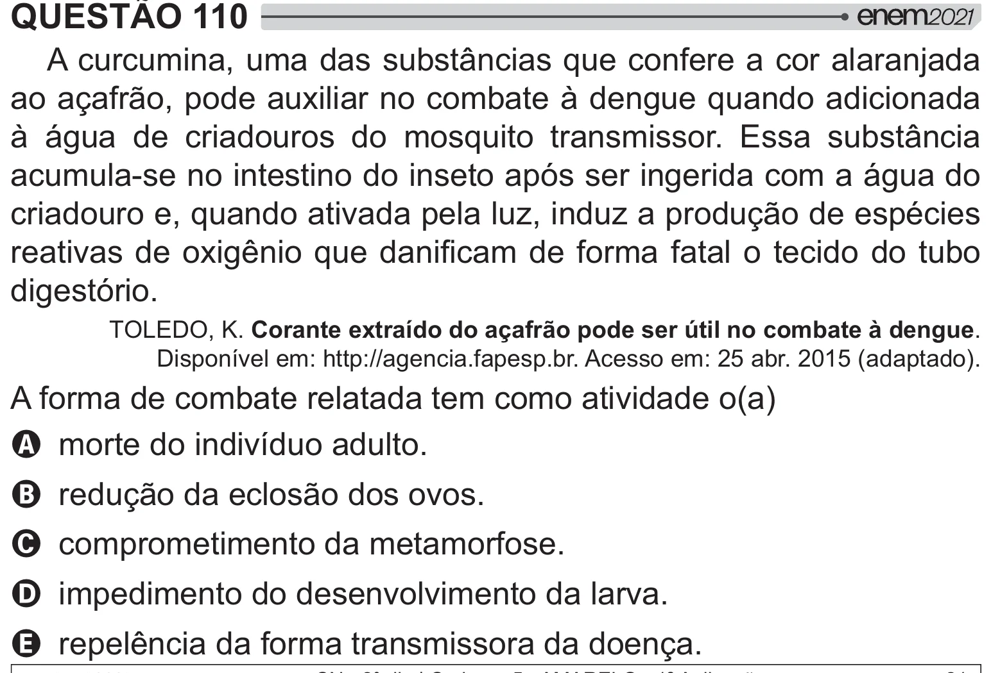

Texto extraído (pode conter ruído)

QUESTÃO 110  
A curcumina, uma das substâncias que confere a cor alaranjada  
ao açafrão, pode auxiliar no combate à dengue quando adicionada  
à água de criadouros do mosquito transmissor. Essa substância  
acumula-se no intestino do inseto após ser ingerida com a água do  
criadouro e, quando ativada pela luz, induz a produção de espécies  
  "  *+  
 >>   y  
digestório.  
TOLEDO, K. Corante extraído do açafrão pode ser útil no combate à dengue.  
Disponível em: http://agencia.fapesp.br. Acesso em: 25 abr. 2015 (adaptado).  
A forma de combate relatada tem como atividade o(a)  
A morte do indivíduo adulto.  
B redução da eclosão dos ovos.  
C comprometimento da metamorfose.  
D impedimento do desenvolvimento da larva.  
E repelência da forma transmissora da doença.

