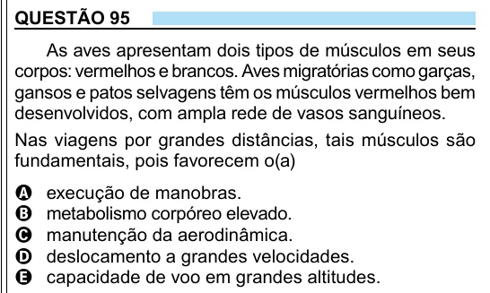

Texto extraído (pode conter ruído)

QUESTÃO 95  
As aves apresentam dois tipos de músculos em seus  
corpos: vermelhos e brancos. Aves migratórias como garças,  
gansos e patos selvagens têm os músculos vermelhos bem  
desenvolvidos, com ampla rede de vasos sanguíneos.  
Nas viagens por grandes distâncias, tais músculos são  
fundamentais, pois favorecem o(a)  
A  
execução de manobras.  
metabolismo corpóreo elevado.  
B  
manutenção da aerodinâmica.  
C  
deslocamento a grandes velocidades.  
D  
capacidade de voo em grandes altitudes.  
E

