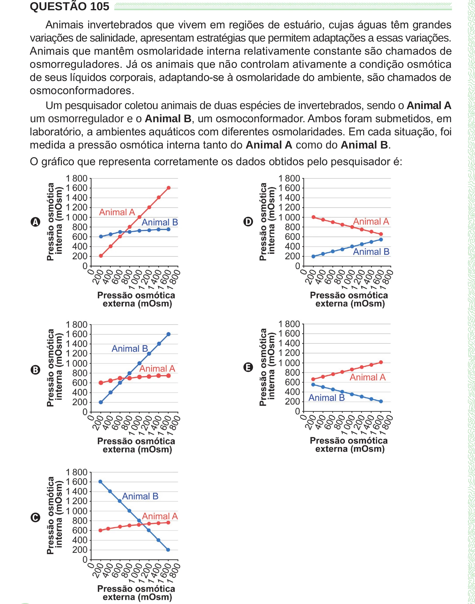

Texto extraído (pode conter ruído)

QUESTÃO 105  
Animais invertebrados que vivem em regiões de estuário, cujas águas têm grandes  
variações de salinidade, apresentam estratégias que permitem adaptações a essas variações.  
Animais que mantêm osmolaridade interna relativamente constante são chamados de  
osmorreguladores. Já os animais que não controlam ativamente a condição osmótica  
de seus líquidos corporais, adaptando-se à osmolaridade do ambiente, são chamados de  
osmoconformadores.  
Um pesquisador coletou animais de duas espécies de invertebrados, sendo o Animal A  
um osmorregulador e o Animal B, um osmoconformador. Ambos foram submetidos, em  
laboratório, a ambientes aquáticos com diferentes osmolaridades. Em cada situação, foi  
medida a pressão osmótica interna tanto do Animal A como do Animal B.  
O gráfico que representa corretamente os dados obtidos pelo pesquisador é:  
D  
A  
E  
B  
C

