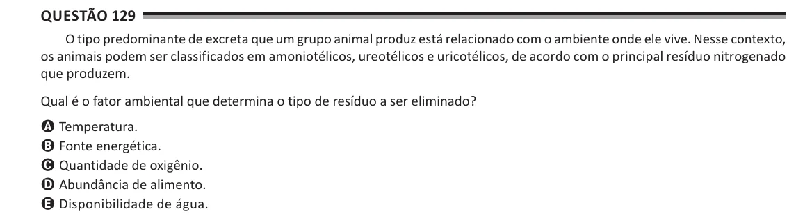

Texto extraído (pode conter ruído)

Questão 129  
O tipo predominante de excreta que um grupo animal produz está relacionado com o ambiente onde ele vive. Nesse contexto,  
os animais podem ser classificados em amoniotélicos, ureotélicos e uricotélicos, de acordo com o principal resíduo nitrogenado  
que produzem.  
Qual é o fator ambiental que determina o tipo de resíduo a ser eliminado?  
A Temperatura.  
B Fonte energética.  
C Quantidade de oxigênio.  
D Abundância de alimento.  
E Disponibilidade de água.

