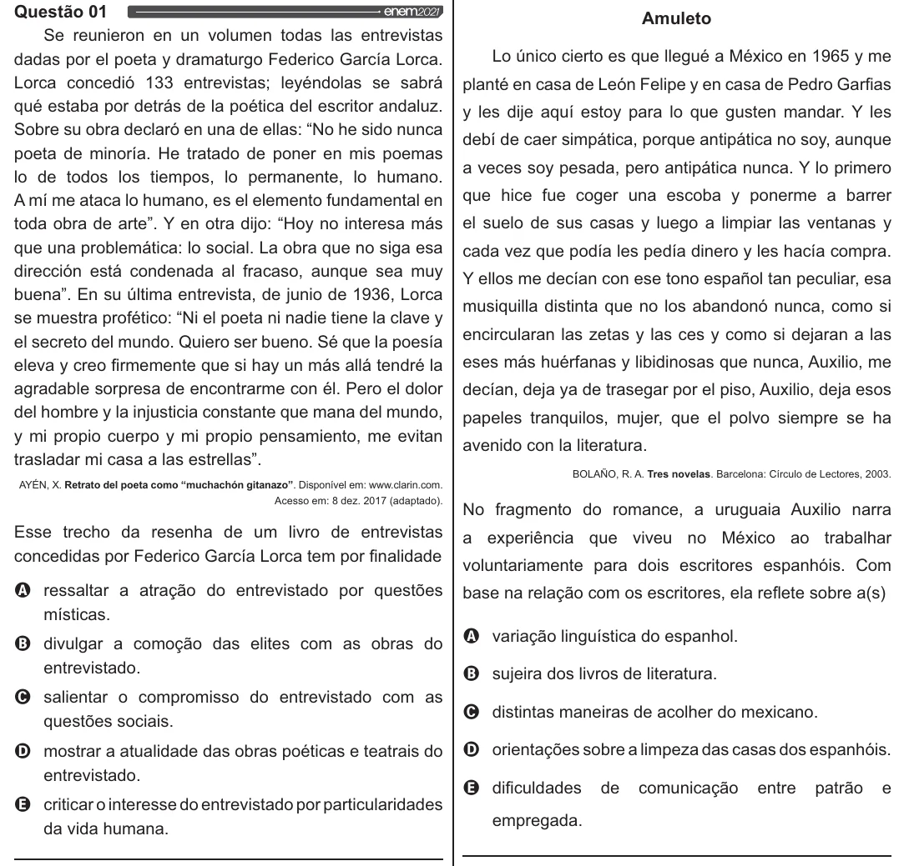

Texto extraído (pode conter ruído)

Questão 01  
Amuleto  
Se reunieron en un volumen todas las entrevistas  
Lo único cierto es que Ilegué a México en 1965 y me  
dadas por el poeta y dramaturgo Federico Garcia Lorca.  
Lorca concedió 133 entrevistas; leyéndolas se sabrá  
planté en casa de León Felipe y en casa de Pedro Garfias  
qué estaba por detrás de la poética del escritor andaluz.  
y les dije aquí estoy para lo que gusten mandar. Y les  
Sobre su obra declaró en una de ellas: “No he sido nunca  
debí de caer simpática, porque antipática no soy, aunque  
poeta de minoria. He tratado de poner en mis poemas  
a veces soy pesada, pero antipática nunca. Y lo primero  
lo de todos los tiempos, lo permanente, lo humano.  
que hice fue coger una escoba y ponerme a barrer  
A mí me ataca lo humano, es el elemento fundamental en  
toda obra de arte”. Y en otra dijo: “Hoy no interesa más  
el suelo de sus casas y luego a limpiar las ventanas y  
que una problemática: lo social. La obra que no siga esa  
cada vez que podia les pedia dinero y les hacia compra.  
dirección está condenada al fracaso, aunque sea muy  
Y ellos me decian con ese tono espafiol tan peculiar, esa  
buena”. En su última entrevista, de junio de 1936, Lorca  
musiquilla distinta que no los abandonó nunca, como si  
se muestra profético: “Ni el poeta ni nadie tiene la clave y  
encircularan las zetas y las ces y como si dejaran a las  
el secreto del mundo. Quiero ser bueno. Sé que la poesia  
eleva y creo firmemente que si hay un más allá tendré la  
eses más huérfanas y libidinosas que nunca, Auxilio, me  
agradable sorpresa de encontrarme con él. Pero el dolor  
decian, deja ya de trasegar por el piso, Auxilio, deja esos  
del hombre y la injusticia constante que mana del mundo,  
papeles tranquilos, mujer, que el polvo siempre se ha  
y mi propio cuerpo y mi propio pensamiento, me evitan  
avenido con la literatura.  
trasladar mi casa a las estrellas”.  
BOLANO, R. A. Tres novelas. Barcelona: Círculo de Lectores, 2003.  
AYÉN, X. Retrato del poeta como “muchachón gitanazo”. Disponível em: www.clarin.com.  
Acesso em: 8 dez. 2017 (adaptado).  
No fragmento do romance, a uruguaia Auxilio narra  
Esse trecho da resenha de um livro de entrevistas  
a experiência que viveu no México ao trabalhar  
concedidas por Federico Garcia Lorca tem por finalidade  
voluntariamente para dois escritores espanhóis. Com  
O ressaltar a atração do entrevistado por questões  
base na relação com os escritores, ela reflete sobre a(s)  
místicas.  
Q variação linguística do espanhol.  
O divulgar a comoção das elites com as obras do  
entrevistado. O sujeira dos livros de literatura.  
O salientar o compromisso do entrevistado com as o . .  
» = O distintas maneiras de acolher do mexicano.  
questões sociais.  
O mostrar a atualidade das obras poéticas e teatrais do | O orientações sobre a limpeza das casas dos espanhóis.  
entrevistado. . .  
& dificuldades de comunicação entre patrão e  
Q criticaro interesse do entrevistado por particularidades  
da vida humana. empregada.

