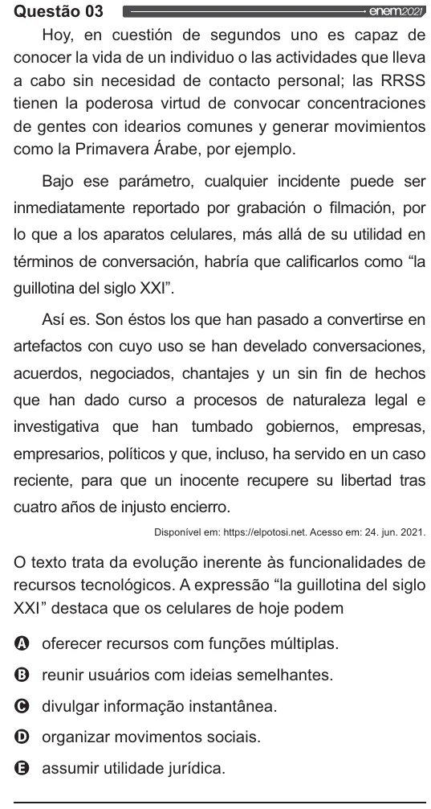

Texto extraído (pode conter ruído)

Questão 03  
Hoy, en cuestión de segundos uno es capaz de  
conocer la vida de un individuo o las actividades que lleva  
a cabo sin necesidad de contacto personal; las RRSS  
tienen la poderosa virtud de convocar concentraciones  
de gentes con idearios comunes y generar movimientos  
como la Primavera Árabe, por ejemplo.  
Bajo ese parámetro, cualquier incidente puede ser  
inmediatamente reportado por grabación o filmación, por  
lo que a los aparatos celulares, más allá de su utilidad en  
términos de conversación, habría que calificarlos como “la  
guillotina del siglo XXI”.  
Así es. Son éstos los que han pasado a convertirse en  
artefactos con cuyo uso se han develado conversaciones,  
acuerdos, negociados, chantajes y un sin fin de hechos  
que han dado curso a procesos de naturaleza legal e  
investigativa que han tumbado gobiemos, empresas,  
empresarios, políticos y que, incluso, ha servido en un caso  
reciente, para que un inocente recupere su libertad tras  
cuatro afios de injusto encierro.  
Disponível em: https://elpotosi.net. Acesso em: 24. jun. 2021.  
O texto trata da evolução inerente às funcionalidades de  
recursos tecnológicos. A expressão “la guillotina del siglo  
XXI” destaca que os celulares de hoje podem  
OQ oferecer recursos com funções múltiplas.  
O reunir usuários com ideias semelhantes.  
Voo  
divulgar informação instantânea.  
organizar movimentos sociais.  
assumir utilidade jurídica.

