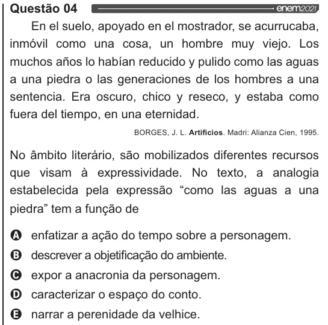

Texto extraído (pode conter ruído)

Questão 04  
En el suelo, apoyado en el mostrador, se acurrucaba,  
inmóvil como una cosa, un hombre muy viejo. Los  
muchos afios lo habían reducido y pulido como las aguas  
a una piedra o las generaciones de los hombres a una  
sentencia. Era oscuro, chico y reseco, y estaba como  
fuera del tiempo, en una eternidad.  
BORGES, J. L. Artificios. Madri: Alianza Cien, 1995.  
No âmbito literário, são mobilizados diferentes recursos  
que visam à expressividade. No texto, a analogia  
estabelecida pela expressão “como las aguas a una  
piedra” tem a função de  
Q enfatizar a ação do tempo sobre a personagem.  
O descrever a objetificação do ambiente.  
O expor a anacronia da personagem.  
O caracterizar o espaço do conto.  
& narrar a perenidade da velhice.

