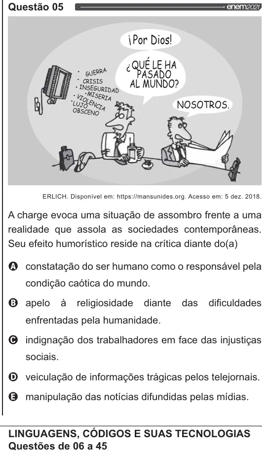

Texto extraído (pode conter ruído)

Questão 05  
iPor Dios!  
: QUÉ LE HA  
Ee SET  
oo AL MUNDO?  
NOSOTROS.  
ERLICH. Disponível em: https://mansunides.org. Acesso em: 5 dez. 2018.  
A charge evoca uma situação de assombro frente a uma  
realidade que assola as sociedades contemporâneas.  
Seu efeito humorístico reside na crítica diante do(a)  
Q constatação do ser humano como o responsável pela  
condição caótica do mundo.  
O apelo à  
religiosidade diante das dificuldades  
enfrentadas pela humanidade.  
O indignação dos trabalhadores em face das injustiças  
sociais.  
O veiculação de informações trágicas pelos telejornais.  
& manipulação das notícias difundidas pelas mídias.  
LINGUAGENS, CÓDIGOS E SUAS TECNOLOGIAS  
Questões de 06 a 45

