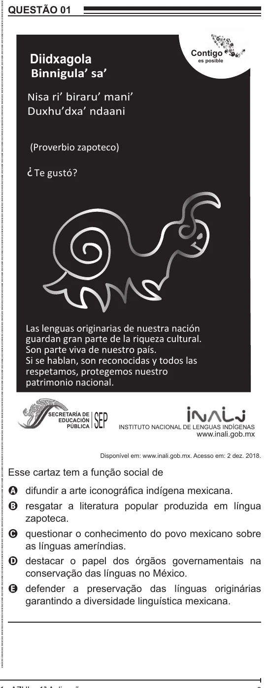

Texto extraído (pode conter ruído)

QUESTÃO 01  
Diidxagola  
Contigo  
es posible  
Binnigula’ sa’  
N isa ri’ biraru’ mani’  
Duxhu’dxa’ ndaani  
(Proverbio zapoteco)  
?  
Te gustó?  
Las lenguas originarias de nuestra nación  
guardan gran parte de la riqueza cultural.  
Son parte viva de nuestro país.  
Si se hablan, son reconocidas y todos las  
respetamos, protegemos nuestro  
patrimonio nacional.  
SEP  
SECRETARÍA DE  
EDUCACIÓN  
PÚBLICA  
INSTITUTO NACIONAL DE LENGUAS INDÍGENAS  
www.inali.gob.mx  
Disponível em: www.inali.gob.mx. Acesso em: 2 dez. 2018.  
Esse cartaz tem a função social de  
A difundir a arte iconográfica indígena mexicana.  
B resgatar a literatura popular produzida em língua  
zapoteca.  
C questionar o conhecimento do povo mexicano sobre  
as línguas ameríndias.  
D destacar o papel dos órgãos governamentais na  
conservação das línguas no México.  
E defender a preservação das línguas originárias  
garantindo a diversidade linguística mexicana.

