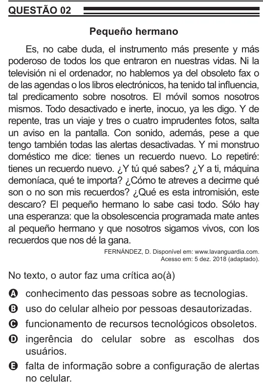

Texto extraído (pode conter ruído)

QUESTÃO 02  
Pequeño hermano  
Es, no cabe duda, el instrumento más presente y más  
poderoso de todos los que entraron en nuestras vidas. Ni la  
televisión ni el ordenador, no hablemos ya del obsoleto fax o  
de las agendas o los libros electrónicos, ha tenido tal influencia,  
tal predicamento sobre nosotros. El móvil somos nosotros  
mismos. Todo desactivado e inerte, inocuo, ya les digo. Y de  
repente, tras un viaje y tres o cuatro imprudentes fotos, salta  
un aviso en la pantalla. Con sonido, además, pese a que  
tengo también todas las alertas desactivadas. Y mi monstruo  
doméstico me dice: tienes un recuerdo nuevo. Lo repetiré:  
tienes un recuerdo nuevo. ¿Y tú qué sabes? ¿Y a ti, máquina  
demoníaca, qué te importa? ¿Cómo te atreves a decirme qué  
son o no son mis recuerdos? ¿Qué es esta intromisión, este  
descaro? El pequeño hermano lo sabe casi todo. Sólo hay  
una esperanza: que la obsolescencia programada mate antes  
al pequeño hermano y que nosotros sigamos vivos, con los  
recuerdos que nos dé la gana.  
FERNÁNDEZ, D. Disponível em: www.lavanguardia.com.  
Acesso em: 5 dez. 2018 (adaptado).  
No texto, o autor faz uma crítica ao(à)  
conhecimento das pessoas sobre as tecnologias.  
A  
uso do celular alheio por pessoas desautorizadas.  
B  
funcionamento de recursos tecnológicos obsoletos.  
C  
ingerência do celular sobre as escolhas dos  
D  
usuários.  
E falta de informação sobre a configuração de alertas  
no celular.

