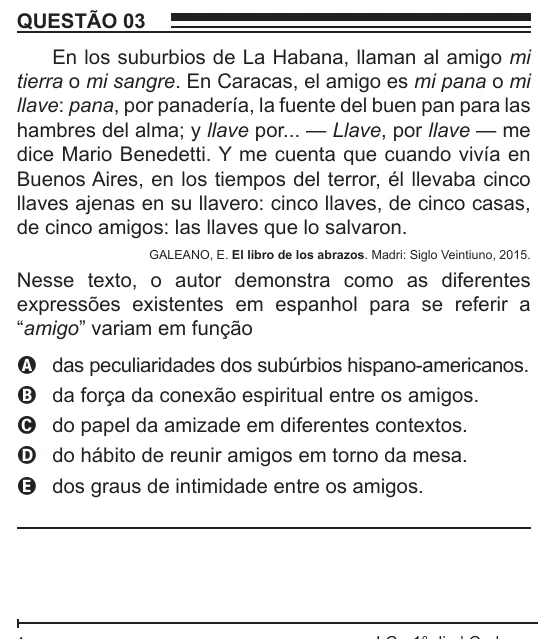

Texto extraído (pode conter ruído)

QUESTÃO 03  
En los suburbios de La Habana, llaman al amigo mi  
tierra o mi sangre. En Caracas, el amigo es mi pana o mi  
llave: pana, por panadería, la fuente del buen pan para las  
hambres del alma; y llave por... — Llave, por llave — me  
dice Mario Benedetti. Y me cuenta que cuando vivía en  
Buenos Aires, en los tiempos del terror, él llevaba cinco  
llaves ajenas en su llavero: cinco llaves, de cinco casas,  
de cinco amigos: las llaves que lo salvaron.  
GALEANO, E. El libro de los abrazos. Madri: Siglo Veintiuno, 2015.  
Nesse texto, o autor demonstra como as diferentes  
expressões existentes em espanhol para se referir a  
“amigo” variam em função  
A  
das peculiaridades dos subúrbios hispano-americanos.  
B  
da força da conexão espiritual entre os amigos.  
do papel da amizade em diferentes contextos.  
C  
do hábito de reunir amigos em torno da mesa.  
D  
dos graus de intimidade entre os amigos.  
E

