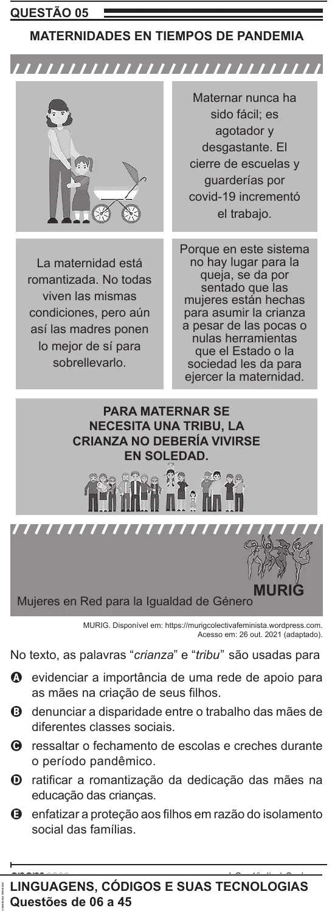

Texto extraído (pode conter ruído)

QUESTÃO 05  
MATERNIDADES EN TIEMPOS DE PANDEMIA  
Maternar nunca ha  
sido fácil; es  
agotador y  
desgastante. El  
cierre de escuelas y  
guarderías por  
covid-19 incrementó  
el trabajo.  
Porque en este sistema  
La maternidad está  
no hay lugar para la  
queja, se da por  
romantizada. No todas  
sentado que las  
viven las mismas  
mujeres están hechas  
condiciones, pero aún  
para asumir la crianza  
a pesar de las pocas o  
así las madres ponen  
nulas herramientas  
lo mejor de sí para  
que el Estado o la  
sobrellevarlo.  
sociedad les da para  
ejercer la maternidad.  
PARA MATERNAR SE  
NECESITA UNA TRIBU, LA  
CRIANZA NO DEBERÍA VIVIRSE  
EN SOLEDAD.  
MURIG  
Mujeres en Red para la Igualdad de Género  
MURIG. Disponível em: https://murigcolectivafeminista.wordpress.com.  
Acesso em: 26 out. 2021 (adaptado).  
No texto, as palavras “crianza” e “tribu” são usadas para  
A evidenciar a importância de uma rede de apoio para  
as mães na criação de seus filhos.  
B denunciar a disparidade entre o trabalho das mães de  
diferentes classes sociais.  
C ressaltar o fechamento de escolas e creches durante  
o período pandêmico.  
D ratificar a romantização da dedicação das mães na  
educação das crianças.  
E enfatizar a proteção aos filhos em razão do isolamento  
social das famílias.  
LINGUAGENS, CÓDIGOS E SUAS TECNOLOGIAS  
Questões de 06 a 45

